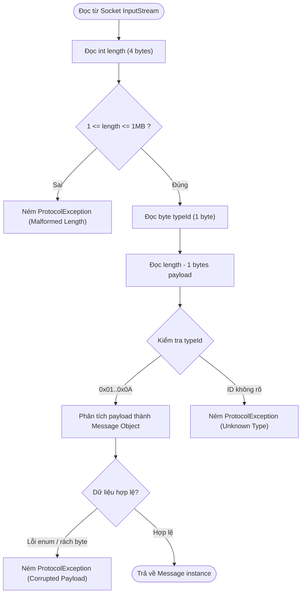
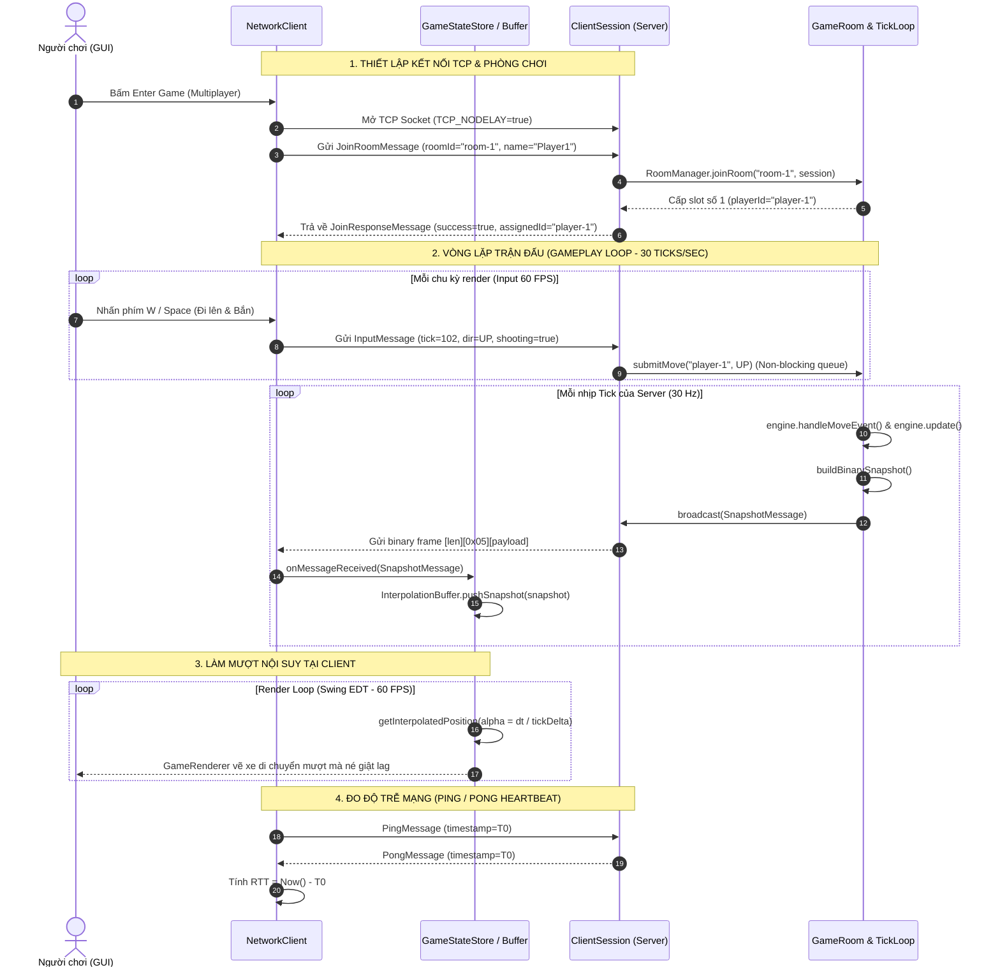

# THIẾT KẾ GIAO THỨC MẠNG & LUỒNG GIAO TIẾP CLIENT - SERVER (TANKOPS)
**Kiến trúc, Sơ đồ chi tiết và Mã giả (Pseudo-code) cho module Giao tiếp Mạng**

---

## 1. Cấu trúc Khung Gói tin & Phân cấp Message

### 1.1. Cấu trúc khung nhị phân trên đường truyền (Wire Framing Layout)
Mọi gói tin truyền qua socket TCP giữa Client và Server đều tuân theo chuẩn khung nhị phân có tiền tố độ dài:

```
+---------------------------+-----------------------+------------------------------------------+
|  Length (int32 - 4 bytes) | Type ID (byte - 1 byte) |       Payload ((Length - 1) bytes)       |
+---------------------------+-----------------------+------------------------------------------+
```

* **Length (4 bytes, Big-Endian)**: Tổng số byte còn lại của khung (`1` byte cho Type ID + toàn bộ payload). Bắt buộc $1 \le \text{Length} \le 1,048,576$ (1 MB).
* **Type ID (1 byte)**: Định danh loại bản tin (`0x01` đến `0x0A`).
* **Payload**: Toàn bộ các trường dữ liệu của bản tin được serialize bằng `DataOutputStream`.

---

### 1.2. Sơ đồ Phân cấp Kế thừa Giao thức (Class Diagram)

```mermaid
classDiagram
    direction TB
    class Message {
        <<sealed interface>>
        +getTypeId() byte
    }
    
    class JoinRoomMessage {
        +String roomId
        +String playerName
        +byte TYPE_ID = 0x01
    }
    class JoinResponseMessage {
        +boolean success
        +String message
        +String roomId
        +String assignedPlayerId
        +int playerNumber
        +byte TYPE_ID = 0x02
    }
    class LeaveRoomMessage {
        +String roomId
        +String playerId
        +byte TYPE_ID = 0x03
    }
    class InputMessage {
        +String playerId
        +int tick
        +Direction direction
        +boolean shooting
        +byte TYPE_ID = 0x04
    }
    class SnapshotMessage {
        +int tick
        +List~TankSnapshot~ tanks
        +List~BulletSnapshot~ bullets
        +boolean gameOver
        +String winnerId
        +byte TYPE_ID = 0x05
    }
    class GameOverMessage {
        +String winnerId
        +Map scores
        +byte TYPE_ID = 0x06
    }
    class EventMessage {
        +EventType eventType
        +String sourceId
        +String targetId
        +double x, y
        +byte TYPE_ID = 0x07
    }
    class PingMessage {
        +long timestamp
        +byte TYPE_ID = 0x08
    }
    class PongMessage {
        +long timestamp
        +byte TYPE_ID = 0x09
    }
    class ChatMessage {
        +String sender
        +String content
        +byte TYPE_ID = 0x0A
    }

    Message <|.. JoinRoomMessage
    Message <|.. JoinResponseMessage
    Message <|.. LeaveRoomMessage
    Message <|.. InputMessage
    Message <|.. SnapshotMessage
    Message <|.. GameOverMessage
    Message <|.. EventMessage
    Message <|.. PingMessage
    Message <|.. PongMessage
    Message <|.. ChatMessage
```



---

## 2. Quy trình Xử lý của Bộ mã hóa / Giải mã (`MessageCodec`)

### 2.1. Lưu đồ Giải mã & Kiểm soát Lỗi an toàn (Decoding Flowchart)



### 2.2. Pseudo-code cho `MessageCodec`

```python
class MessageCodec:
    MAX_SIZE = 1048576 # 1 MB giới hạn trần phòng vệ DoS

    function encode(message: Message) -> bytes:
        payload_stream = new ByteArrayOutputStream()
        
        # 1. Ghi dữ liệu payload tương ứng với từng kiểu Message
        match message:
            case JoinRoomMessage(roomId, playerName):
                writeUTF(roomId)
                writeUTF(playerName)
                
            case JoinResponseMessage(success, msg, roomId, assignedId, slot):
                writeBoolean(success)
                writeUTF(msg)
                writeUTF(roomId)
                writeUTF(assignedId)
                writeInt(slot)
                
            case InputMessage(playerId, tick, direction, isShooting):
                writeUTF(playerId)
                writeInt(tick)
                # Cho phép null Direction (0 = đứng yên, 1..4 = UP, DOWN, LEFT, RIGHT)
                writeByte(direction != null ? direction.ordinal + 1 : 0)
                writeBoolean(isShooting)
                
            case SnapshotMessage(tick, tanks, bullets, gameOver, winnerId):
                writeInt(tick)
                writeBoolean(gameOver)
                writeUTF(winnerId != null ? winnerId : "")
                writeInt(tanks.size())
                for t in tanks:
                    writeUTF(t.id), writeDouble(t.x), writeDouble(t.y)
                    writeByte(t.dir != null ? t.dir.ordinal + 1 : 0)
                    writeInt(t.health), writeInt(t.maxHealth), writeInt(t.starLevel)
                    writeBoolean(t.shielded), writeBoolean(t.moving), writeBoolean(t.destroyed)
                writeInt(bullets.size())
                for b in bullets:
                    writeUTF(b.id), writeUTF(b.ownerId), writeDouble(b.x), writeDouble(b.y)
                    writeByte(b.dir != null ? b.dir.ordinal + 1 : 0)

            case GameOverMessage(winnerId, scores):
                writeUTF(winnerId != null ? winnerId : "")
                writeInt(scores.size())
                for (pId, score) in scores:
                    writeUTF(pId), writeInt(score)

            case PingMessage(time):
                writeLong(time)

            case PongMessage(time):
                writeLong(time)

        payload_bytes = payload_stream.toByteArray()
        total_frame_length = 1 + payload_bytes.length

        if total_frame_length > MAX_SIZE:
            throw ProtocolException("Payload vượt quá kích thước cho phép")

        # 2. Đóng khung nhị phân chuẩn [Length][TypeID][Payload]
        frame_stream = new ByteArrayOutputStream()
        writeInt(total_frame_length)
        writeByte(message.getTypeId())
        write(payload_bytes)

        return frame_stream.toByteArray()

    function readMessage(in_stream: DataInputStream) -> Message:
        # 1. Đọc tiền tố độ dài
        length = in_stream.readInt()
        if length < 1 or length > MAX_SIZE:
            throw ProtocolException("Độ dài gói tin không hợp lệ: " + length)

        # 2. Đọc mã Type ID và phần thân Payload
        typeId = in_stream.readByte()
        payload_bytes = in_stream.readFully(length - 1)
        payload_in = new DataInputStream(payload_bytes)

        # 3. Khôi phục đối tượng Message tương ứng
        match typeId:
            case 0x01:
                return new JoinRoomMessage(payload_in.readUTF(), payload_in.readUTF())
            case 0x02:
                return new JoinResponseMessage(
                    payload_in.readBoolean(), payload_in.readUTF(), 
                    payload_in.readUTF(), payload_in.readUTF(), payload_in.readInt()
                )
            case 0x04:
                return new InputMessage(
                    payload_in.readUTF(), payload_in.readInt(),
                    readDirection(payload_in), payload_in.readBoolean()
                )
            case 0x05:
                return parseSnapshotMessage(payload_in)
            case 0x06:
                return parseGameOverMessage(payload_in)
            case 0x08:
                return new PingMessage(payload_in.readLong())
            case 0x09:
                return new PongMessage(payload_in.readLong())
            case default:
                throw ProtocolException("Type ID không tồn tại: " + hex(typeId))
```

---

## 3. Sơ đồ Luồng Giao tiếp Toàn hệ thống (Sequence Diagram)



---

## 4. Pseudo-code Các Thành phần Thực thi

### 4.1. Server: Luồng tiếp nhận phiên (`ClientSession`)

```python
class ClientSession implements Runnable:
    socket: Socket
    currentRoom: GameRoom
    playerId: String

    function run():
        socket.setTcpNoDelay(true)
        in_stream = new DataInputStream(socket.getInputStream())
        out_stream = new DataOutputStream(socket.getOutputStream())

        try:
            while isRunning and not Thread.interrupted():
                # Giải mã nhị phân bản tin đến
                msg = MessageCodec.readMessage(in_stream)

                match msg:
                    case JoinRoomMessage(roomId, name):
                        room = roomManager.joinRoom(roomId, this)
                        this.currentRoom = room
                        send(new JoinResponseMessage(true, "OK", roomId, playerId, room.getPlayerCount()))

                    case InputMessage(pId, tick, dir, isShoot):
                        if this.currentRoom != null:
                            # Đẩy vào ConcurrentLinkedQueue của phòng (Single-writer pattern)
                            this.currentRoom.submitMove(playerId, dir)

                    case PingMessage(time):
                        send(new PongMessage(time))

                    case LeaveRoomMessage(roomId, pId):
                        if this.currentRoom != null:
                            roomManager.leaveRoom(roomId, this)
                            this.currentRoom = null
                            
        except (EOFException, ProtocolException, IOException):
            cleanupConnection()
```

### 4.2. Client: Bộ đệm nội suy mượt mà (`InterpolationBuffer`)

```python
class InterpolationBuffer:
    prevSnapshot: SnapshotMessage = null
    currSnapshot: SnapshotMessage = null
    prevTime: long = 0
    currTime: long = 0

    function pushSnapshot(newSnapshot: SnapshotMessage):
        prevSnapshot = currSnapshot
        prevTime = currTime
        currSnapshot = newSnapshot
        currTime = currentTimeMillis()

    function getInterpolatedPosition(tankId: String) -> Vector2D:
        if currSnapshot == null:
            return null
            
        currTank = currSnapshot.findTank(tankId)
        if currTank == null:
            return null

        # Nếu chưa đủ 2 snapshot thì render tọa độ snapshot mới nhất
        if prevSnapshot == null or prevTime == 0:
            return Vector2D(currTank.x, currTank.y)

        prevTank = prevSnapshot.findTank(tankId)
        if prevTank == null:
            return Vector2D(currTank.x, currTank.y)

        # Tính tỷ lệ nội suy alpha trong khoảng [0.0, 1.0]
        timeDelta = currTime - prevTime
        elapsed = currentTimeMillis() - currTime
        alpha = clamp(elapsed / timeDelta, 0.0, 1.0)

        # Công thức nội suy tuyến tính (Linear Interpolation - LERP)
        interpX = prevTank.x + (currTank.x - prevTank.x) * alpha
        interpY = prevTank.y + (currTank.y - prevTank.y) * alpha

        return Vector2D(interpX, interpY)
```

---

## 5. Kết luận & Tiêu chuẩn Kiểm định Đã Đạt được

* **Tiêu chí TC06 (Protocol Round-Trip)**: Đã được kiểm thử với 11 test case con trong [`MessageCodecTest.java`](file:///d:/TankOps/tankops-common/src/test/java/tankops/common/net/MessageCodecTest.java), đảm bảo `decode(encode(msg)).equals(msg)` với độ chính xác 100%.
* **Tiêu chí TC07 (Malformed Message)**: Đã được kiểm thử với 5 kịch bản lỗi (độ dài âm, độ dài vượt 1MB, Type ID không xác định, payload bị cắt ngang, enum ordinal hỏng), chứng minh hệ thống ném `ProtocolException` an toàn và không gây crash tiến trình.

